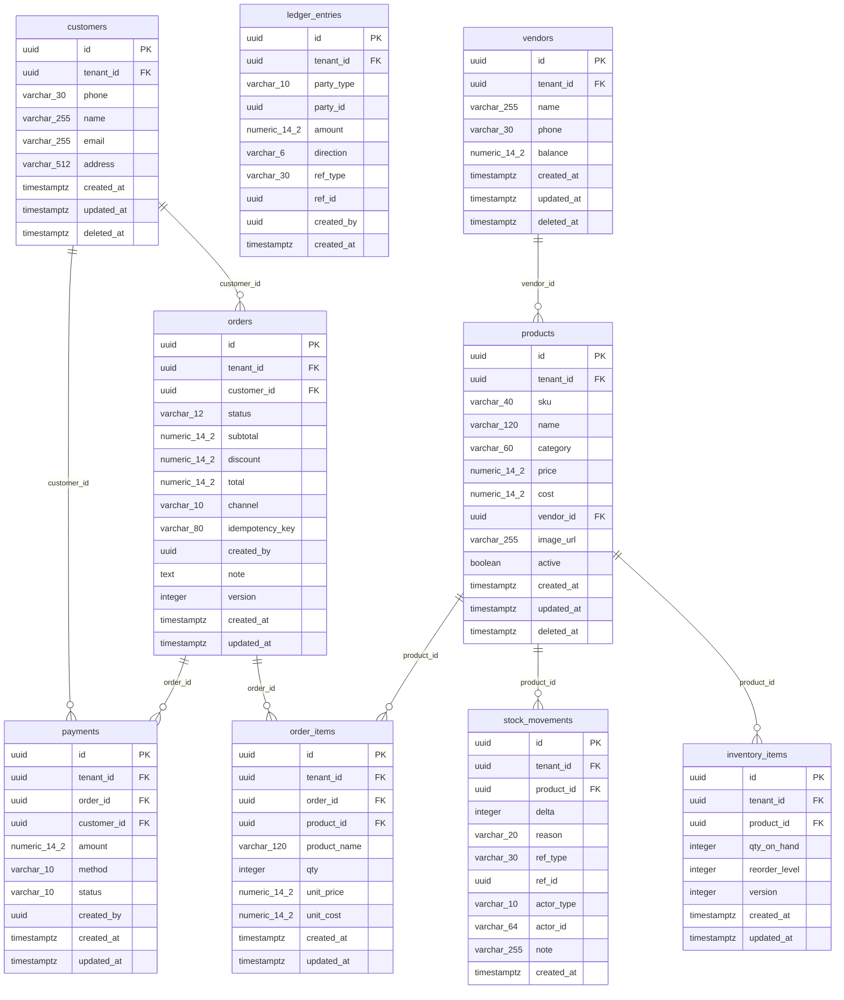

# Catalog, inventory and sales — ERD

> Generated from the schema by `docs/erd/generate_erd.py`. Do not hand-edit the diagram;
> edit `catalog-sales-finance.template.md` for the prose.

What the shop sells, what is on the shelf and why it changed, who buys, and how a sale becomes money owed. `vendors` is
shown only so the link from a product to its supplier is visible; it is documented in
[purchasing-vendors.md](purchasing-vendors.md). Back to the [overview](overview.md).

## Tables

| Table | One row is | Notes |
| --- | --- | --- |
| `products` | A thing the shop sells | Soft-deleted. `sku` is unique per shop among live rows. `cost` is optional (profit leaves out sales of products without one). `image_url` is a path inside a private storage bucket, never a public URL. |
| `inventory_items` | The stock of one product | One row per (shop, product). `qty_on_hand` can never be negative; `reorder_level` drives the low-stock automation. Carries `version`. |
| `stock_movements` | One change to stock | Append-only. `delta` is never zero; `reason` says why (opening, sale, purchase, adjustment, return or reversal); `actor_type` says whether a person or an agent did it. |
| `customers` | A person who buys | Soft-deleted. Phone is the natural key (unique per shop). |
| `orders` | A posted sale | Carries `version`. `status` is draft, posted, reversed or cancelled; `channel` is `pos`, `chat`, `whatsapp` or `voice`. `idempotency_key` makes a retried request return the same order. Reversal creates compensating rows, never deletes. |
| `order_items` | One line of an order | Price and quantity as sold. |
| `payments` | Money received against an order or a customer's credit | `amount` is always positive; `method` is cash, card, bank or wallet; `status` is completed or reversed. |
| `ledger_entries` | One movement on a customer's (or vendor's) running balance | Append-only. `direction` is debit or credit; the balance is the sum of the entries and is never stored. |

## Unenforced relationships

| Column | Points at | Why there is no FK |
| --- | --- | --- |
| `ledger_entries.party_type` + `party_id` | A customer, or a vendor | One ledger serves both customer credit (udhaar) and vendor payables, so the party is a type plus an id. |
| `ledger_entries.ref_type` + `ref_id` | An order, payment, vendor bill or vendor payment | The entry records what caused it; the cause can be in several tables. |
| `stock_movements.ref_type` + `ref_id` | An order, or an approved agent action | Same reason. |
| `stock_movements.actor_id`, `orders.created_by`, `payments.created_by`, `ledger_entries.created_by` | A user, or a fixed id for an AI agent | An agent is not a user, and history must not break when a person is removed. |

## Notable design choices

- **A sale is one transaction.** Order, lines, stock movements, payment and ledger entry are written together or not at
  all; a duplicate request with the same idempotency key returns the existing order.
- **Stock is changed only by movements.** `inventory_items.qty_on_hand` is the running total, and every change to it has
  a `stock_movements` row, so any quantity can be traced to a sale, purchase or adjustment.
- **Credit is a ledger, not a column.** What a customer owes is derived from `ledger_entries`, so it always reconciles
  to the orders and payments behind it.
- **Money is `NUMERIC(14,2)`.** Never a float.
