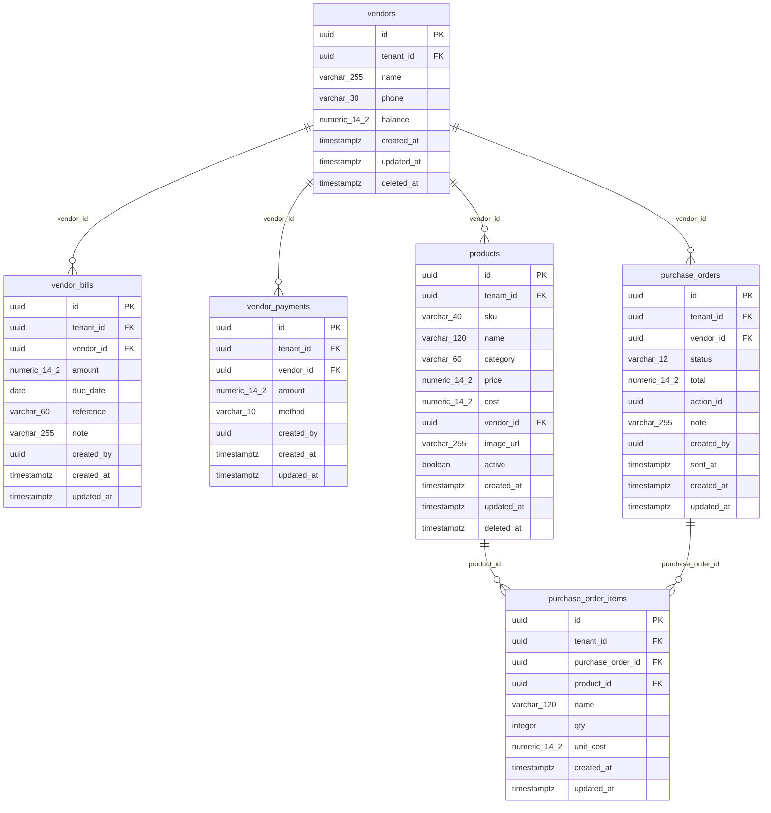

# Purchasing and vendors — ERD

> Generated from the schema by `docs/erd/generate_erd.py`. Do not hand-edit the diagram;
> edit `purchasing-vendors.template.md` for the prose.

Who the shop buys from, what it owes them, and the draft orders the low-stock automation prepares. `products` is shown
only for the links into it; it is documented in [catalog-sales-finance.md](catalog-sales-finance.md). Back to the
[overview](overview.md).

## Tables

| Table | One row is | Notes |
| --- | --- | --- |
| `vendors` | A supplier | Soft-deleted. `balance` is **no longer written**: what the shop owes is the sum of the vendor's `ledger_entries` (`party_type = 'vendor'`). |
| `vendor_bills` | A bill a vendor sent | `amount` is above zero; optional due date and reference. Writing one also writes the matching ledger entry. |
| `vendor_payments` | Money the shop paid a vendor | `amount` is above zero; `method` is cash, card, bank or wallet. Refused when it is more than is owed. |
| `purchase_orders` | A draft order to one vendor | `status` is `drafted`, `approved`, `sent` or `cancelled`. `total` is an estimate: lines whose cost is unknown count for nothing. Never changes stock or the ledger. |
| `purchase_order_items` | One product on a draft order | Keeps the product's `name` as it was when drafted, plus `qty` and `unit_cost` (null when the product has no cost). |

## Unenforced relationships

| Column | Points at | Why there is no FK |
| --- | --- | --- |
| `purchase_orders.action_id` | `agent_actions.id` (the approval that sends the reorder message) | The approval lives in the AI context; the order must survive if approvals are archived. Indexed with `tenant_id` to find the order when its message is sent. |
| `vendor_bills.created_by`, `vendor_payments.created_by`, `purchase_orders.created_by` | A user | History must not break when a person is removed. |

## Notable design choices

- **Payables use the same ledger as customer credit.** One append-only table, one way to reconcile.
- **A purchase order is a plan, not a movement.** Receiving goods and paying the vendor are separate, manual steps
  (bill, payment), so a draft can never move money or stock by itself.
- **A vendor without a phone number still gets a draft order**, left open with a warning, so the need to reorder is not
  lost (PRD W-006 failure path).
