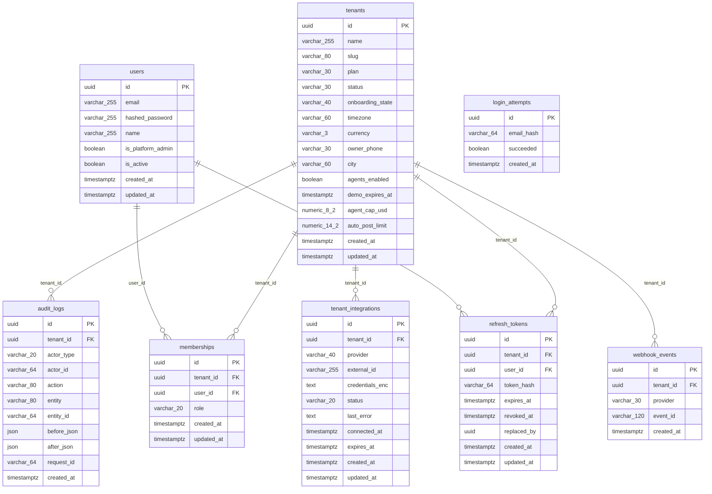

# Tenancy and security — ERD

> Generated from the schema by `docs/erd/generate_erd.py`. Do not hand-edit the diagram;
> edit `tenancy-security.template.md` for the prose.

Who a shop is, who works in it, how they sign in, which outside services are connected, and the trail of what happened.
Back to the [overview](overview.md).

## Tables

| Table | One row is | Notes |
| --- | --- | --- |
| `tenants` | A shop | Not tenant-scoped itself. Holds the shop's plan, `status` (active or suspended), timezone, currency, `agents_enabled` switch, per-shop AI cap (`agent_cap_usd`) and `auto_post_limit` (agent sales under it post without asking; default 0 = always ask). `demo_expires_at` marks a temporary demo shop. |
| `users` | A person who can sign in | Global: one person may belong to several shops. |
| `memberships` | A person's role in one shop | `owner`, `manager` or `staff`. One row per (shop, person). |
| `refresh_tokens` | A signed-in session that can be renewed | Only a hash (`token_hash`) is stored, never the token. Renewing replaces it (`replaced_by`); signing out sets `revoked_at`. |
| `login_attempts` | One sign-in try | Global. The email is stored only as a hash. Failed tries inside a time window drive the lock-out; older rows are purged. |
| `tenant_integrations` | A shop's connection to a provider | `provider` is `whatsapp_twilio`, `facebook` or `vapi` today (`whatsapp_meta` and `instagram` are reserved). `status` is pending, connected, error or revoked. `credentials_enc` is encrypted at rest and never returned by the API. One row per (shop, provider). |
| `webhook_events` | A provider event already processed | Unique per (shop, provider, event id), so a replayed webhook is ignored. |
| `audit_logs` | One state-changing action | Append-only; who (`actor_type`, `actor_id`), what (`action`), on which record (`entity`, `entity_id`), before and after. |

## Unenforced relationships

These point at another table but have no database foreign key, on purpose.

| Column | Points at | Why there is no FK |
| --- | --- | --- |
| `audit_logs.entity` + `audit_logs.entity_id` | Any record in any table | One log covers every entity, so the target is a name plus an id (text), and the row must outlive the record. |
| `audit_logs.actor_id` | A user, or a fixed id for an AI agent or system job | Agents and scheduled jobs are not users. |
| `tenant_integrations.external_id` | The provider's own id (Twilio account SID, Facebook page id) | It is the key a webhook is routed by, so it is globally unique per provider rather than per shop. |

## Notable design choices

- **Authorization is checked in the API, then again by the database.** The role comes from the signed token; row level
  security stops a bug in the API from reading another shop's rows.
- **`login_attempts` has no shop.** It is written before anyone is signed in, so it is global by design.
- **Secrets are encrypted before they are stored** (`credentials_enc`), with a key held outside the database.
